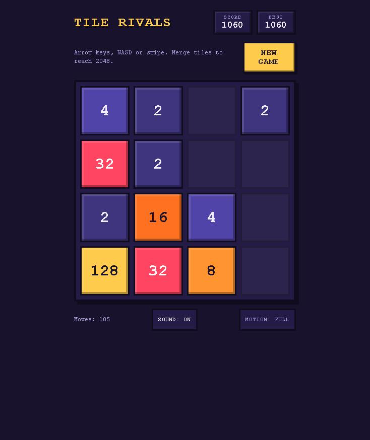
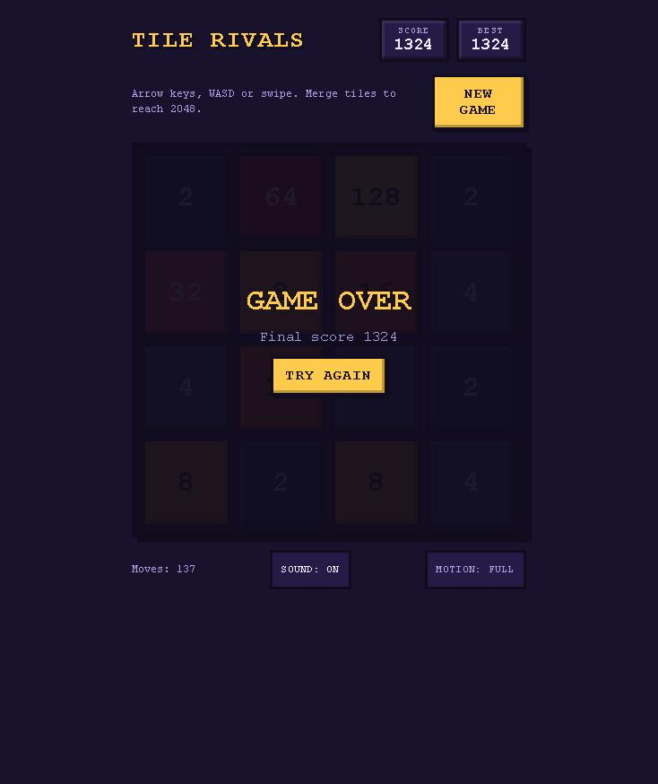
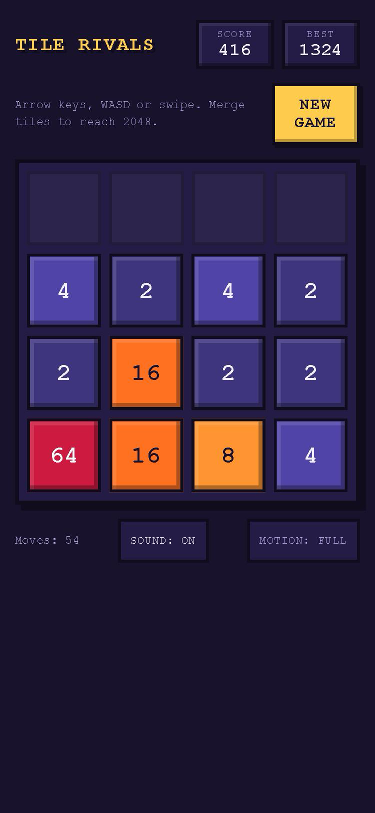
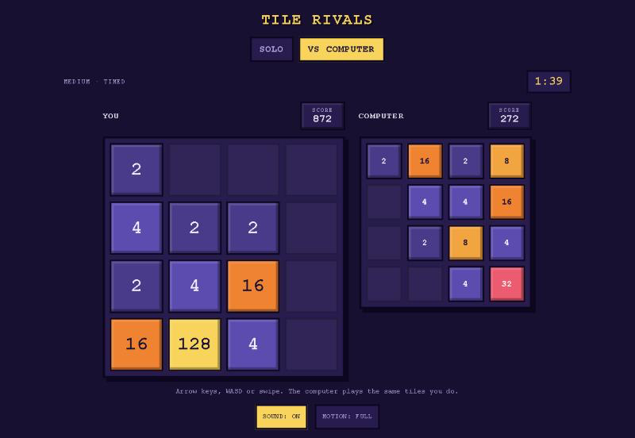

# Tile Rivals

A real-time, online 2048 with a retro pixel look. Race a friend or the computer on **identical boards**: both players get the same seeded tile spawns, so the winner is the better player, not the luckier one.

> **Status:** early development. Solo mode and the computer opponent are playable (milestones M0 to M3 done). Online play with a friend is still to come and is marked below. Demo GIF and live link will appear here at v1.0.

## Screenshots

Current build. Solo mode, then a match against the computer:

| Gameplay | Game over | Mobile |
|---|---|---|
|  |  |  |

**Versus the computer** (same tiles for both sides, live clock, three difficulty levels):



## Features

Checked items are shipped; the rest follow the milestone plan in [docs/plan.md](docs/plan.md).

- [x] Deterministic 2048 engine shared by client and server (M1): pure functions, seeded spawns, replayable from `seed + moves`, 41 tests
- [x] Solo mode (M1): keyboard (arrows/WASD) and swipe, best score saved locally, game over and "keep going" after 2048
- [x] Game feel (M2): tile slide, spawn and merge animations, score pop, screen shake on big merges, synthesized chiptune sound (merge pitch rises with tile value), sound and reduced-motion settings that persist
- [x] vs Computer (M3): expectimax AI with Easy / Medium / Hard, 3-2-1 countdown, both match formats (Timed Race, First to 2048), rematch. Same seed for both sides, so identical spawn luck. See [AI opponent](#ai-opponent)
- [ ] vs Friend online with room codes (M4)
- [x] Two match formats: Timed Race and First to 2048 (M3 for the computer; friend matches in M4)
- [ ] Reconnect handling and rate limiting (M5)
- [ ] Accessibility, tutorial, mobile polish (M6)

## How it was built

The build is documented as it happens, not reconstructed afterwards.

- **Plan:** [docs/plan.md](docs/plan.md): goals, design, architecture, 14-day schedule, risks.
- **Dev log:** [docs/devlog/](docs/devlog/): one short entry per work session.
- **Decisions:** [docs/decisions/](docs/decisions/): one-page records of choices with trade-offs.
- **Changelog:** [CHANGELOG.md](CHANGELOG.md).

## Game industry design standards

Each row is marked done only when implemented and verified. See the full definitions in [docs/plan.md](docs/plan.md#4-game-industry-design-standards-we-will-follow).

| Standard | Status | How it is verified |
|---|---|---|
| Game feel / juice | Done (M2) | Slide, spawn-pop, merge-pop, score pop, shake and pitch-scaled sound. Animation layout checked in-browser: 0 misaligned tiles over a full game |
| Input responsiveness | Done (M2) | Moves fire on keydown and apply instantly; animations are cosmetic and never block input, so there is nothing to queue. Rapid-fire test (273 keys, no pauses) ended with no lock-ups or overlapping tiles |
| Clarity and feedback | Done (M2) | Every action gives visual and audio feedback; no-op moves give none and are not counted. Tile-tracking is fuzz-tested against the engine over 25 games |
| Onboarding (first-time experience) | Planned (M6) | |
| Fairness (seeded spawns, server authority) | Seeded spawns done (M1), used in vs Computer (M3); server authority planned (M4) | Test: two players on one seed get the same spawn value for the same spawn number |
| Netcode basics | Planned (M4, M5) | |
| Accessibility | Planned (M6) | |
| Difficulty curve | Done (M3) | Three tiers with measured results (table below); no rubber-banding, so the AI never cheats. Tier ordering is a test |
| Player-safety defaults | Planned | |
| Performance | Planned (M2, M7) | |
| Persistence and settings | Planned (M6) | |
| Playtesting | Planned (M7) | |
| Docs | In progress | Plan, dev log, ADRs present |
| **Repo hygiene / privacy** | **Done (M0)** | `npm run privacy` runs in CI and as a pre-commit hook |

## AI opponent

The computer uses **expectimax search** over the same engine the game runs on ([shared/ai.ts](shared/ai.ts)). On its turn it tries each move, then averages over the tiles the game might spawn next, looking a few moves ahead. A board is scored by how many cells are empty, how many merges are available, whether rows and columns run smoothly from big to small, and whether the biggest tile sits in a corner. Line scores are cached, so a search takes about 1.5 ms on the hardest setting.

| Tier | Look-ahead | Deliberate mistakes | Move pace |
|---|---|---|---|
| Easy | 1 move (greedy) | 30% random moves | 650 ms |
| Medium | 2 moves | 8% random moves | 420 ms |
| Hard | 3 moves | none | 260 ms |

The mistakes come from the seeded random stream, not `Math.random`, so the AI is deterministic: the same board always gets the same answer, which keeps tests stable. It never gets better tiles than you; both sides share one spawn sequence.

**Benchmark:** 50 full games per tier on fixed seeds 1 to 50, no move limit, run with `npm run benchmark:ai`.

| Tier | Reached 512 | Reached 1024 | Reached 2048 | Reached 4096 | Median score | Avg time per move |
|---|---|---|---|---|---|---|
| Easy | 0% | 0% | 0% | 0% | 2,396 | 0.01 ms |
| Medium | 66% | 24% | 0% | 0% | 6,388 | 0.06 ms |
| Hard | 98% | 92% | 76% | 36% | 37,072 | 1.57 ms |

These are unlimited games. In a live match the pace and the clock cap how far the computer gets: in a 2-minute Timed Race Hard makes about 460 moves, far short of a full game, so you can beat it with fast, clean play. First to 2048 with its 10-minute cap is the tougher test. The pace values are a first guess; playtests (M7) will tune them.

## Tech stack

TypeScript everywhere · React + Vite (client) · Node + Socket.IO (server) · Vitest · GitHub Actions.
Pixel art is drawn in CSS/SVG and sound is synthesized with the Web Audio API, so there are no asset files.

## Run it yourself

Requires Node 20 or newer.

```bash
git clone https://github.com/tokenlimitben/tile-rivals.git
cd tile-rivals
npm install
npm run setup        # enables the pre-commit privacy hook
npm run dev:server   # terminal 1: Socket.IO server on port 3001
npm run dev:client   # terminal 2: client on http://localhost:5173
```

Other scripts: `npm test`, `npm run typecheck`, `npm run privacy`, `npm run check` (all three), `npm run build`, `npm run benchmark:ai`.

## Repo hygiene

This repo is public-safe by construction: no absolute paths, personal email, machine names or secrets in code, docs, images or history. Screenshots show only the game page (no desktop, browser chrome or file paths) and are saved as plain PNGs with no embedded text metadata. Commits use a GitHub `noreply` identity, the `.gitignore` blocks local tooling config and env files, source maps are off in production builds, and an automated script (`scripts/check-privacy.mjs`) scans files and history in CI and before each commit.

## License

[MIT](LICENSE)
